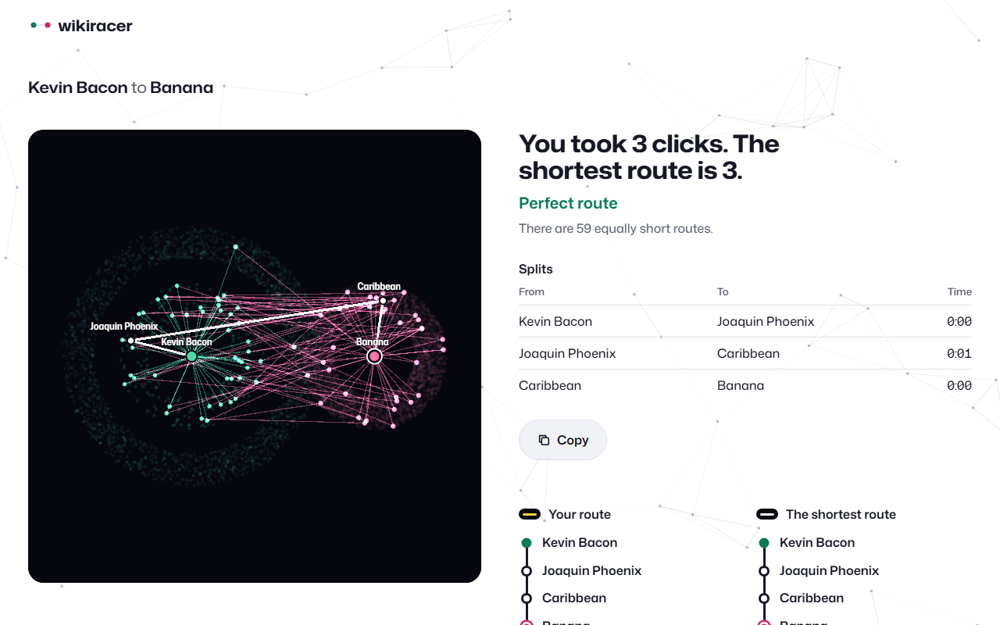

# Wikiracer



Race from one Wikipedia article to another using only the links in the articles, in as few clicks as you can. When you reach the finish, the site shows you the shortest route: a search spreads out from both articles at once, and you watch the two fronts meet in the middle. Then you see your route next to the shortest one. There's a daily course, random courses at three difficulties, courses you set yourself, and rooms where up to four friends race the same course live or through a challenge link.

**Play it:** https://wikiracer.kieronoates.workers.dev

## Why I built this

I built Wikiracer to show what I can make end to end, from a data pipeline to a polished game you can play on your phone. Each part was a problem I wanted to solve properly:

- **A search across all of Wikipedia, with no search server.** I turn Wikipedia's 11 GB of SQL dumps into a map of 7 million articles and 713 million links, then encode it so the browser can find every shortest route by reading only a megabyte or so of it. It's hosted for free as static files.
- **Showing an algorithm, not just its answer.** The reveal draws the breadth-first search as it really runs: two fronts growing from each end until they meet. I wrote the WebGL2 renderer myself so it can draw 50,000 nodes smoothly, even on a phone.
- **A fair race on live Wikipedia.** Articles load straight from Wikipedia and are rewritten on the fly, so only real article links count, and there's no Back or Find to cheat with.
- **Multiplayer on the free tier.** Live rooms for up to eight players run on a Cloudflare Worker with a Durable Object per room, and their WebSockets hibernate between moves, so an idle room costs nothing.
- **Keeping it up to date.** A scheduled GitHub Actions run rebuilds and republishes the map each month when a new dump comes out, and checks real searches before it goes live.

## Running it locally

You need Node 24.

```sh
npm install
npm run dev        # the site, with search against the live map
npm run build      # type-check and build into dist/
npx wrangler dev   # the built site plus the room server, after a build
```

Rebuilding the map needs about 20 GB of disk and 16 GB of RAM:

```sh
npm run map:build    # download the dumps, build the graph, encode the map, make the courses
npm run map:publish  # push the map to the data sites
npm run map:check    # run real searches against them
```

## Tech

Svelte 5, TypeScript, Vite, WebGL2, Web Workers, Cloudflare Workers and Durable Objects, Cloudflare Turnstile, GitHub Pages for the map data.

## Credits and licences

- My code is MIT licensed (see `LICENSE`).
- Article text and the link data come from [English Wikipedia](https://en.wikipedia.org/), by its contributors, under [CC BY-SA 4.0](https://creativecommons.org/licenses/by-sa/4.0/). The map files are a derived work under the same licence.
- [Mona Sans](https://github.com/github/mona-sans) by GitHub, SIL Open Font License 1.1.
- [Svelte](https://svelte.dev/) and [Vite](https://vite.dev/), MIT. [TypeScript](https://www.typescriptlang.org/), Apache 2.0. [Wrangler](https://github.com/cloudflare/workers-sdk), MIT or Apache 2.0.
